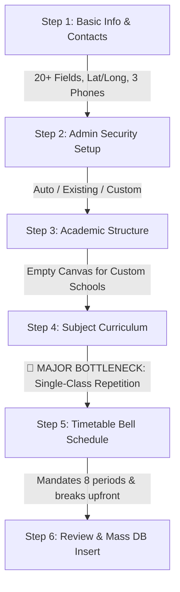
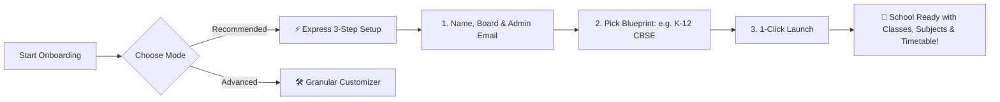

# Vidyon Institution Onboarding: Comprehensive Analysis & Simplification Guide

**Document Version:** 1.0  
**Target Flow:** `/admin/onboarding` (Institution Onboarding Wizard)  
**System:** Vidyon Unified Multi-Tenant ERP  
**Scope:** Evaluation of Onboarding Friction, Subject & Class Configuration Complexity, and Implementation Blueprint for Express Onboarding.

---

## 1. Executive Summary & Verdict

| Evaluation Metric | Current Pre-Catalog Onboarding | Current Custom Institution Onboarding | Target Simplified Experience |
|---|---|---|---|
| **Onboarding Difficulty** | **Moderate** (3.5 / 5) | **High / Difficult** (2.0 / 5) | **Extremely Easy** (4.8 / 5) |
| **Total Mandatory Steps** | 6 Linear Steps | 6 Linear Steps | 3 Steps (or 1-Click Express) |
| **Average Time to Complete** | 4 – 6 minutes | **12 – 20 minutes** | **under 90 seconds** |
| **Subject Assignment Clicks** | Pre-assigned 6 subjects for 1 class | **90 – 120 clicks** (Class-by-class) | **1 Click** ("Auto-Populate Curriculum") |
| **Class/Structure Setup** | Auto-loaded from template key | **Manual creation from empty canvas** | **Pre-seeded Smart Blueprint** |
| **Cognitive Load / Fatigue** | Medium | **High (Dropout Risk)** | Minimal |

### Verdict:
The current onboarding wizard is **well-engineered technically**, but from a **User Experience (UX) and operations perspective, it is TOO DIFFICULT and cumbersome**, especially for:
1. **Custom Schools & Colleges** not already in the pre-defined catalog.
2. **Subject Mapping (Step 4)**, which requires repetitive class-by-class assignment.
3. **Over-collection of non-essential metadata upfront** (GPS latitude/longitude, guard phones, transport phones) before the institution is even created.
4. **Timetable entanglement (Step 5)**, forcing bell schedule creation before teachers and students are even enrolled.

---

## 2. Step-by-Step Deep-Dive Analysis: Where It Hurts



### 🔴 Step 1: Institution Basic Info & Contacts
* **Pain Points:**
  * **20+ input fields** on screen 1: Name, Code, Board, Address 1, Address 2, City, State, Pincode, Latitude, Longitude, Google Map Link, Office Phone, Guard Phone, Transport Phone, Academic Year, Allowed Roles.
  * Most school administrators do not know their exact GPS coordinates (`12.9815, 80.2180`) or specific transport/guard dispatch phone numbers when signing up.
  * Overwhelming first impression that feels like a government tax filing rather than a modern SaaS onboarding.

### 🟡 Step 2: Administrator & Security Account
* **Pain Points:**
  * Displays three modes (`auto`, `existing`, `custom`) which can confuse a new user.
  * Password verification logic for existing accounts adds cognitive friction.

### 🔴 Step 3: Academic Structure & Standards (Classes & Sections)
* **Pain Points:**
  * **The Custom Institution Trap:** If an admin clicks `+ Register New Custom School/College`, `structure` is initialized to `[]` (empty array). The screen is completely blank!
  * Admins must manually click `+ Add Group / Stream`, name each group, and then add every single class (`1st Standard`, `2nd Standard`, etc.) and pick sections `[A, B, C]` one by one.
  * To onboard a 12-grade school, the admin has to make **30+ clicks** just to define standard grades and sections.

### 🚨 Step 4: Subject Curriculum & Course Mapping (THE #1 BOTTLENECK)
* **Critical Friction Point:**
  * The wizard offers a **single target class selector**:
    `Select Target Class -> Select Stream -> Select Subjects -> Click 'Assign Selected Subjects'`
  * **There is NO multi-class assignment or "Apply to all Standards" option.**
  * In a standard school with classes from Pre-KG to 12th Standard (15 classes):
    * The admin must select `1st Standard` $\rightarrow$ pick 6 subjects $\rightarrow$ click Assign.
    * Select `2nd Standard` $\rightarrow$ pick 6 subjects $\rightarrow$ click Assign.
    * Repeat this **15 consecutive times**!
  * If a user forgets a class, that class has **zero subjects**, causing Step 5 (Timetable Auto-population) to fail or insert null subject slots into `timetable_slots`.

### 🔴 Step 5: Master Timetable Schedule & Bell Grid
* **Pain Points:**
  * Onboarding forces the institution to configure working days, 8 periods, short breaks, lunch timings, and generates hundreds of `timetable_slots` in the database.
  * In reality, 90% of school administrators want to onboard their school first, add their teachers and students, and configure or adjust their timetable later before term starts.
  * Tying timetable generation to initial onboarding creates massive database upsert payloads (often 400+ slot rows) on the final submission, increasing risk of timeouts.

### 🟡 Step 6: Review & Final Creation
* **Pain Points:**
  * If any step fails (e.g. edge function timeout on user creation, or conflict on timetable slots), the user gets a generic error alert and may end up with a half-created, orphaned institution.

---

## 3. The Solution: How to Make Onboarding Effortless

We propose a **Dual-Track Simplification Strategy**:
1. **Express Auto-Pilot (90-Second Onboarding)**: For 90% of standard schools & colleges.
2. **Modular Customizer**: For institutions that want precise control without repetitive work.



---

## 4. Key Architectural Changes

### Feature 1: "1-Click Full Curriculum Auto-Populate" in Step 4
Instead of forcing 15 repetitive assignments, provide a single prominent hero button:
```tsx
<TouchableOpacity 
  style={styles.magicCurriculumBtn}
  onPress={handleOneClickCurriculumAutoFill}
>
  <Sparkles size={18} color="#FFFFFF" />
  <Text style={styles.magicBtnText}>
    Auto-Assign Standard Board Curriculum to All {allAvailableClasses.length} Classes
  </Text>
</TouchableOpacity>
```
* **What it does automatically:**
  * For Pre-KG to UKG: Assigns Phonics, Rhymes, Numeracy, Art, Storytelling.
  * For 1st to 5th: Assigns English, Math, EVS, 2nd Language, Computer Basics, PE.
  * For 6th to 10th: Assigns English, Math, Science, Social Studies, 2nd Language, Computer Applications, PE.
  * For 11th & 12th (Science): Assigns Physics, Chemistry, Math, Biology / Computer Science, English Core.
  * For 11th & 12th (Commerce): Assigns Accountancy, Business Studies, Economics, Business Math, English Core.
  * For Engineering Colleges: Assigns Anna Univ / AICTE Semester Core subjects across Year 1 to 4.
* **Result:** **1 click replaces 90 manual dropdown selections!**

---

### Feature 2: Smart Pre-Seeded Blueprint for Custom Institutions
When the user chooses `+ Register New Custom School` or `+ Register New Custom College`:
* **Never leave the structure empty (`[]`).**
* Automatically load the default standard template (e.g., `school_private_k12` or `college_private_engineering`) as an editable starter kit.
* Show a helpful banner:
  > *"We've pre-loaded a verified K-12 structure (Pre-KG to 12th). Feel free to remove or add classes as needed."*

---

### Feature 3: Progressive Disclosure for Step 1
Divide Step 1 into **Essential Information** and **Optional Details**:
* **Essential (Visible by default):**
  1. Institution Name
  2. Institution Category (School / College)
  3. Board / Affiliation (CBSE, ICSE, State Board, Anna Univ, etc.)
  4. City & State
  5. Official Email
  6. Institution ID / Code (Auto-generated from name)
* **Optional Logistics (Collapsed in Accordion):**
  * `[+ Add Campus GPS, Guard & Transport Contacts (Optional)]`
  * Latitude / Longitude (Auto-lookup button via City/Pincode)
  * Guard phone & Transport phone
  * Map link & Address Line 2

---

### Feature 4: "Timetable: Quick Defaults or Setup Later" Toggle in Step 5
Add a clean two-option toggle:
* **Option A (Default & Recommended):** *"Apply Standard Timetable Preset (8 Periods, 08:30 - 15:30) & Generate Slots Automatically"*
* **Option B:** *"Skip Timetable Generation for Now (Configure in Timetable Module after adding Staff & Students)"*
* This relieves the pressure of finalizing periods during initial institution creation.

---

### Feature 5: Bulk Section Cloning in Step 3
Add a top action bar in Step 3:
* `[Set All Classes to Sections A & B]`
* `[Set All Classes to Single Section A]`
* Saves administrators from having to click the section multi-select for every individual class.

---

## 5. UI/UX Flow Comparison (Before vs After)

| Step | Current Experience (Before) | Optimized Experience (After) | Improvement |
|---|---|---|---|
| **Step 1** | 22 inputs across 4 sections. Must find GPS coords & 3 separate phone numbers. | 6 core fields. GPS and auxiliary phones tucked into an expandable accordion. | **70% less visual noise** |
| **Step 2** | Choice of 3 modes with verification checks. | Auto-generated admin email with clear explanation: "Admin sets password on first login." | **Zero ambiguity** |
| **Step 3** | Empty screen for custom schools. Must add every class and section manually. | Verified starter structure pre-loaded. 1-click button to adjust sections across all classes. | **Instant progress, 0 blank screens** |
| **Step 4** | Select Class $\rightarrow$ Select Stream $\rightarrow$ Select Subjects $\rightarrow$ Add $\rightarrow$ Repeat 15x. | **"Auto-Assign Standard Curriculum" button** fills all classes in 1 second. Individual edit chips remain available for fine-tuning. | **From 15 minutes to 1 second** |
| **Step 5** | Mandatory deep timetable setup generating 400+ database rows. | 1-Click Template preset or "Skip and setup in Timetable module later". | **Prevents DB bottlenecks & user fatigue** |
| **Step 6** | Technical summary and full commit. | Clear summary cards with "Onboard & Go to Dashboard" or "Add Staff/Students". | **Smooth transition to operations** |

---

## 6. Implementation Plan & Code Blueprint

### Blueprint 1: Multi-Class Curriculum Auto-Populator Helper

Create a dedicated curriculum helper in `src/constants/institutionTemplates.ts`:

```typescript
export function generateDefaultCurriculumForStructure(
  structure: GroupStructureItem[],
  category: InstitutionCategory,
  board: string = 'CBSE'
): SubjectTemplateItem[] {
  const generatedSubjects: SubjectTemplateItem[] = [];

  for (const group of structure) {
    for (const cls of group.classes) {
      const name = cls.name.toLowerCase();

      // Kindergarten
      if (name.includes('kg')) {
        ['Phonics & English', 'Rhymes & Storytelling', 'Early Numeracy', 'Art & Play', 'General Awareness'].forEach(
          (sub, i) => {
            generatedSubjects.push({
              name: sub,
              code: `KG-${i + 1}`,
              className: cls.name,
              group: 'Pre-Primary',
            });
          }
        );
      }
      // Primary (1st to 5th)
      else if (['1st', '2nd', '3rd', '4th', '5th'].some(s => name.includes(s))) {
        ['English', 'Mathematics', 'Environmental Science (EVS)', 'Second Language (Tamil/Hindi)', 'Computer Basics', 'Physical Education'].forEach(
          (sub, i) => {
            generatedSubjects.push({
              name: sub,
              code: `PRI-${i + 1}`,
              className: cls.name,
              group: 'Primary Core',
            });
          }
        );
      }
      // Middle & Secondary (6th to 10th)
      else if (['6th', '7th', '8th', '9th', '10th'].some(s => name.includes(s))) {
        ['English Language & Lit', 'Mathematics', 'Science (Physics, Chem, Bio)', 'Social Studies (History & Geo)', 'Second Language', 'Computer Science & AI', 'Physical Education'].forEach(
          (sub, i) => {
            generatedSubjects.push({
              name: sub,
              code: `SEC-${i + 1}`,
              className: cls.name,
              group: 'Secondary Core',
            });
          }
        );
      }
      // Higher Secondary (11th & 12th)
      else if (['11th', '12th'].some(s => name.includes(s))) {
        ['English Core', 'Physics', 'Chemistry', 'Mathematics', 'Computer Science / Biology'].forEach(
          (sub, i) => {
            generatedSubjects.push({
              name: sub,
              code: `HSC-${i + 1}`,
              className: cls.name,
              group: 'Science Stream',
            });
          }
        );
      }
      // Colleges (Engineering / Arts)
      else {
        const corePool = category === 'college'
          ? MASTER_SUBJECTS_CATALOG.college_engineering_core.slice(0, 6)
          : MASTER_SUBJECTS_CATALOG.school_core.slice(0, 6);

        corePool.forEach(sub => {
          generatedSubjects.push({
            name: sub.name,
            code: sub.code,
            className: cls.name,
            group: 'Core',
          });
        });
      }
    }
  }

  return generatedSubjects;
}
```

### Blueprint 2: Updating Custom Institution Selection in Onboarding Index
In `app/(root)/admin/onboarding/index.tsx`:

```typescript
const handleSelectCatalogInstitution = (catalogId: string) => {
  if (catalogId === '__custom__') {
    setIsCustomInstitution(true);
    setSelectedCatalogId('__custom__');
    
    // Automatically pre-load a default verified structure so custom institutions
    // do NOT start with an empty canvas!
    const defaultTemplateKey = basicInfo.institution_category === 'college'
      ? 'college_private_engineering'
      : 'school_private_k12';
    
    const structTemplate = STRUCTURE_TEMPLATES[defaultTemplateKey];
    if (structTemplate && structure.length === 0) {
      setStructure(
        structTemplate.groups.map((g, gIdx) => ({
          id: `group_${gIdx + 1}`,
          name: g.name,
          stage: g.stage,
          classes: g.classes.map((c, cIdx) => ({
            id: `class_${gIdx + 1}_${cIdx + 1}`,
            name: c.name,
            sections: [...c.sections],
            class_order: c.class_order || cIdx + 1,
            is_final_class: !!c.is_final_class,
          })),
        }))
      );
      setDepartments([...structTemplate.defaultDepartments]);
      
      // Also pre-seed curriculum so Step 4 is 100% ready by default
      const autoSubs = generateDefaultCurriculumForStructure(
        structTemplate.groups,
        basicInfo.institution_category,
        basicInfo.board_or_university
      );
      setSubjects(autoSubs.map((s, idx) => ({ ...s, id: `sub_auto_${idx}` })));
    }
    return;
  }
  // ... rest of catalog selection logic ...
};
```

---

## 7. Immediate Next Steps & Recommendations

1. **Implement `generateDefaultCurriculumForStructure`**: Add the 1-Click curriculum auto-fill function to automatically populate subjects for all classes.
2. **Add "Auto-Populate Curriculum for All Classes" Button to Step 4**: Eliminate the repetitive 15-step manual selection.
3. **Pre-seed Default Blueprint on Custom School Selection**: Ensure administrators never face a blank list of classes when entering a custom school.
4. **Group Step 1 Logistics into an Accordion**: Keep GPS and non-critical telephone fields optional and collapsed by default.
5. **Add "Skip Timetable" Checkbox in Step 5**: Allow institutions to onboard quickly and schedule their timetables when their academic calendar begins.
